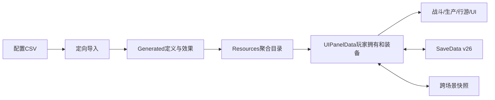

# 系统总览

更新：2026-10-22。玩法规则以[当前游戏体系](../design/当前游戏体系.md)为入口，动作定稿以[动作登记](../guides/动作定稿与重建边界.md)为准。

## 工程与场景

Tuanjie 2022.3.61t14、Built-in、Linear；UI为uGUI。主要自有逻辑编入Assembly-CSharp与Assembly-CSharp-Editor。Unity工程位于cultivation/。

| 场景 | 职责 |
| --- | --- |
| StartScene | 五槽角色菜单、新建/读取 |
| 3C_Testbed | 正式洞府、生产/建筑/修炼、传送野外 |
| Sect_Wilderness | 野外和悬赏妖群 |
| Demon-Suppressing Tower | 塔层、刷怪、清层与返回 |
| WorldAuthoring/RuntimeMapEditor.unity | 独立工坊，制作正式地图 |

古古村、宗门主场景与主线运行器退役。WorldAuthoring源美术不等于仍有旧游玩场景。

## 数据与会话

目录定义与玩家拥有分开。法则保存UUID实例，武器/功法/法宝按稳定ID查定义。SaveApplier每局首次应用磁盘档；普通场景传送优先会话快照，塔内往返另记录真实施放点。地图Map.asset与角色存档分开，HomeWorld重放扩建。

## 运行职责

| 模块 | 入口与职责 |
| --- | --- |
| 角色装配 | 场景自举补公共组件，PlayerAbilityLoader按功法+武器+启用神通的并集开关组件，保留已有Inspector配置 |
| 输入/普攻 | PlayerManualAim分左键功法、E武器、Q法宝引导；BasicAttackGate共享动作锁，两条连招索引分开 |
| 动画/持握 | WeaponCarryAnim按当前武器选覆盖；武器挂载保留模型标定；PlayerAnimationController管理动作与地面/御风衔接 |
| 伤害 | 实际接触进入CombatDamagePipeline，CombatCalculator计算属性，CombatImpactPipeline负责命中反馈 |
| 神通/法宝 | ActiveSkillCaster、各Runner、TreasureCaster、SpiritArrayCaster；神通六槽与法宝Q槽独立 |
| 法则 | LawFragmentSystem生成/拥有/六槽；LawFragmentBalance限制敏感增量；LawRefinementSystem保留炼制业务 |
| 修炼/时间 | PlayerCultivation、时间管理器、日常循环；已解锁等级、总灵气和机会分离 |
| 家园生产 | HomeWorld、灵田、摆设及HomeBuildingState；仓库/生产批次随存档与会话保存 |
| 委托 | 宗门任务数据服务、执事阁UI、野外悬赏刷怪和追踪；不使用旧任务阶段 |
| 镇妖阁 | TowerRealmTreasure接Q，TowerController/TowerProgress管理层数和返回点 |
| 行游 | PlayerController、YufengFlight、MountRider、PlayerTraversalWheel与闪避组件 |
| 外观 | 玩家外观在共享人体Animator下装配当前网格；独立衣发骨链，不引用预览的Transform |
| 角色UI | CharacterPanelUI、UIInkSkin、UIInkBagPage、UIPaperEquipmentOrbit；武器预览UIPaperWeaponPreview |
| HUD/通知 | TreasureSkillHud/UITreasureCarousel、UIRewardNotice与原气血/技能HUD；装饰不接收射线 |
| 地图/画面 | WorldMapLoader/Renderer、GameGlobalBloom/Grade/Outline、地图雾和体素代理 |

原QuestDatabase现主要作物品ID索引，阶段集合为空。通用对话标记仍用于丹方等状态，不能随旧主线删除。

## 维护与交付

优先局部修改和定向导入，禁止为同步目录保存所有场景。源模型/FBX与成品GUID保留。独立预览做动作/素材验证；需要Play时先隔离保存目录，结束核对存档、分辨率和输入状态。当前实现、历史证据与待开发内容分别登记，详见[进度](../PROGRESS.md)、[验收入口](../../devtools/validation/README.md)。
