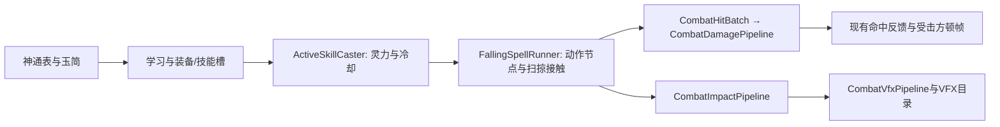

# 主动神通第一波：天降打击

2026-10-13。五门神通由功德堂玉简学习，进入现有神通装备和1～6技能槽；锁定目标施放，或使用现有Alt+技能键/鼠标引导。施放距离使用神识，表中的范围是整个攻击覆盖半径。

## 配置与初版数值

| 神通 | 品阶 | 属性 | 单次倍率 | 数量 | 范围半径 | 灵力 | 冷却 | 玉简贡献 |
| --- | --- | --- | ---: | ---: | ---: | ---: | ---: | ---: |
| 秋锐 | 地品 | 物理 | 0.65 | 18 | 4.2米 | 32 | 8秒 | 120 |
| 雷陨 | 地品 | 特殊 | 0.65 | 24 | 3.5米 | 32 | 7.5秒 | 120 |
| 火岩陨 | 地品 | 特殊 | 4.8 | 1 | 3.8米 | 48 | 10秒 | 160 |
| 剑雨落花 | 天品 | 物理 | 0.8 | 16 | 5.5米 | 50 | 11秒 | 240 |
| 火岩坠 | 天品 | 特殊 | 0.85 | 14 | 7米 | 64 | 15秒 | 240 |

全部为**主动神通**伤害，沿用主动法术加成/减免。物理走暴击，特殊走会心，普攻加成不参与。剑雨和陨石雨逐颗结算；一次接触中的同一敌人多碰撞体只扣一次，不同剑/陨石可以再次命中。

散布采用等面积黄金角分布，第一发在目标中心，其余覆盖引导范围。范围包含单颗命中半径：秋锐0.85米、剑雨落花1.1米、雷陨1.2米、火岩坠2.2米；火岩陨直接使用表中范围。一发的倍率不能按整套雨重复结算。

## 特效与施法动作

源素材为 `Assets/Art/effectReference/Hovl Studio/AOE Magic spells Vol.1/Prefabs`，派生成品集中在 `Assets/resources/Abilities/FallingSpells`，共享源材质/纹理。原始素材和正式场景保持原状。

| 神通 | 源特效 | 动作 | 出手进度 |
| --- | --- | --- | ---: |
| 秋锐 | Knives + Knife hit | 能量02前半施法 | 40% |
| 雷陨 | Lightning strike | 玄霄雷诀A2 | 38% |
| 火岩陨 | Meteor + Meteor hit | 能量03施法 | 42% |
| 剑雨落花 | Magic attack + 原落地闪光 | 能量05施法 | 40% |
| 火岩坠 | Meteor shower + 原碰撞爆炸 | 玄霄雷诀A3 | 45% |

雷陨去掉Start系列蓄力节点和原起手延迟；进入施法节点后以0.06秒间隔连续发出24道落雷，末道约1.38秒发出。原版是循环落雷，不能将其压缩为一次中心雷击。天空闪光跟随每道雷的实际起点，出生子发射器只通过父粒子触发，接触火花只通过真实碰撞触发；不额外在技能中心重复自播。每道独立结算0.65倍伤害，保留主动法术加成，避免将原单雷3.2倍重复24次。落地火花、烟雾和子发射器沿用源结构，真实接触后由统一表现管线播放。灯光半径限制为2.5米，保留火焰/闪光自身发光。

两种剑雨的下落主体均换成 `Assets/TripoModels/sword2/sword2.fbx` 的派生网格，Knife hit主体也替换，爆炸/闪光层保留。源剑存在倾斜，按实际顶点主轴校准；成品 `Assets/Art/Weapons/Sword2/Sword2_TipForward.asset` 以剑尖为原点、+Z为剑尖方向，长度2.2米，随实际飞行来向旋转，剑柄在后。剑雨落花将原激光换成同一实体剑，并保留原法阵和命中层。

插地剑本体关闭原贴片的持续旋转、按速度旋转、生命周期/按速度缩放、噪声、额外力和速度继承，保持剑尖向下、位置和尺寸固定。火花、烟雾、爆炸和闪光子节点的曲线仍保留。秋锐沿用 `ability_jianyu_luo`，剑雨落花沿用 `ability_jianyu_luohua`，玉简ID和资源GUID不变，已有学习和装备引用继续有效。

剑雨落花按用户要求取消整套音效：派生施放体、MagicHit和组合命中体移除EGA_EffectSound及AudioSource；原始素材、秋锐及其他技能的声音不受影响。后续多层椭圆螺旋剑阵见[骤雨初歇](骤雨初歇.md)。

三段新动作使用魔法剑士Humanoid/inplace的energy02/03/05。energy02只抽前50%，成品1.2秒；energy03和energy05保留全段，约1.4/1.433秒。成品位于 `resources/技能动作/神通施法`，去掉XZ根位移及源动画事件，非循环；通过现有 `HandMotionRetargeting` 保留40条指节曲线与腕部手势。沿用现有Animator、全状态施法及高度补偿，其他定稿动作不重建。

## 现有管线中的位置

`ActiveSkillKind.天降打击` 追加为9，不更改既有枚举编号。新增执行体只管理这批素材的弹道时序和几何，伤害公式、暴击/会心、扣血、护盾、死亡、冷却、灵力、顿帧都由原管线处理。施放体和落地特效分别登记为 `<神通id>_cast`、`<神通id>_impact`；通过统一表现入口生成和管理寿命，没有另建伤害计算或命中特效系统。

弹体按完整帧间轨迹进行SphereCast，采用有限的64粒子/32扫掠结果缓冲；接触后移除该粒子，触发原生碰撞子发射器，再走伤害及地表管线。地面很薄或缺失碰撞时，在弹道实际穿过落点平面时补接触；不会等整段技能结束才结算。施法开始到出手之间保持动作占用；暂停冻结时序，施法者失效取消执行体并归还动作，目标销毁时保留预定落点而不会回砸施法者。

地表破坏同样逐颗接入现有局部体素管线，初版采用浅坑：秋锐0.12米、雷陨0.06米、火岩陨0.25米、剑雨落花0.15米、火岩坠0.12米；与生物范围分开配置，不以全技能中心一次挖大坑。

维护入口：神通/玉简数值在两张表；弹数、间隔、出手节点、轨迹与单颗范围在 `FallingSpellPattern`；命中表现/灯光/寿命在 `CombatVfxCatalog`，地表破坏与顿帧在 `CombatImpactCatalog`。菜单 **修仙/神通/重建首批天降神通（不动场景）**，实现 `FirstWaveAbilitiesBaker`，保留成品GUID并更新共享面板/物品目录，不保存场景。动态资源根登记在 `devtools/maintenance/runtime-resource-roots.json`。

## 验证

`active-wave1-editor.cs.txt` 检查五门定义、玉简/面板引用、共享表现目录、剑尖与长度、有限预算、多道范围落雷、去蓄力、名称与固定插地剑、三段人形施法与指节，151项通过。实际玩家近景姿态另做了20/40/70%蒙皮预览。

`active-wave1-runtime.cs.txt` 在独立Play中用真实玩家Avatar、标准控制器、实际碧水兽及临时敌人，检查五门神通的地面/御风/骑乘共15次施放；覆盖出手节点、灵力/冷却、逐颗接触、主动加成/属性路由、碰撞体去重、友方和范围外目标、真实子粒子/统一表现生成、鼠标落点、缺资源/超距/缺灵力失败原子性，以及暂停/中断/目标销毁；雷陨额外检查24次接触分散覆盖与附近单位受伤。276项通过。`active-wave1-stability.cs.txt` 经统一表现入口播放两种插地剑，在0.15～0.75秒连续采样其位置、旋转和尺寸，并检查剑尖朝下，16项通过。结果和实拍只放 `.local/diagnostics/active-wave1`，不写正式场景或玩家存档。

关联：[战斗与伤害](../architecture/战斗与伤害.md)、[特效资源清单](特效资源清单.md)、[资产与目录](../architecture/资产与目录.md)。
